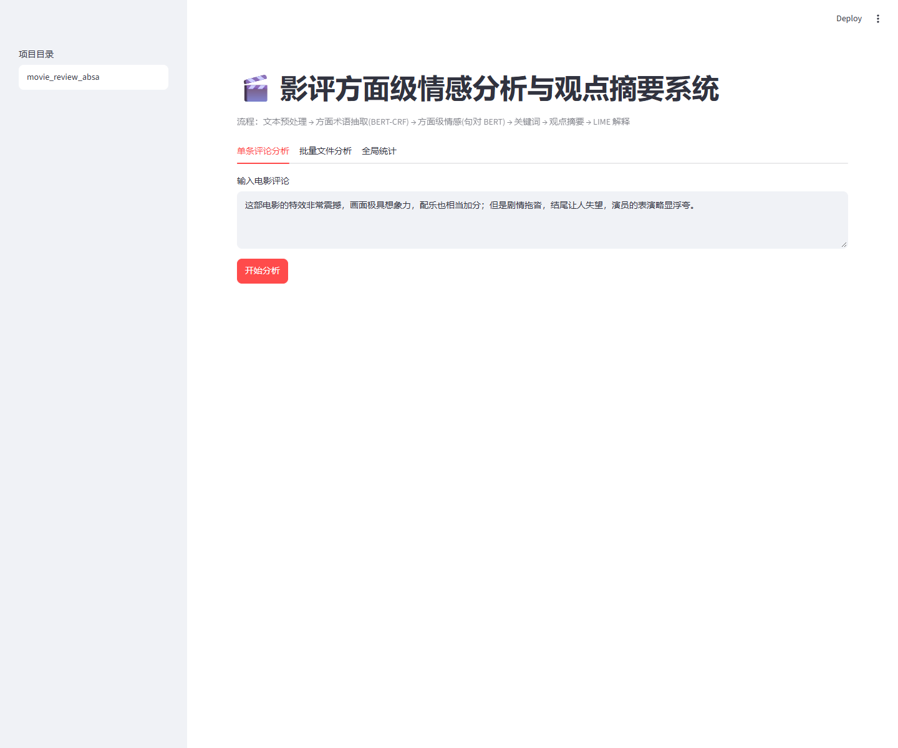
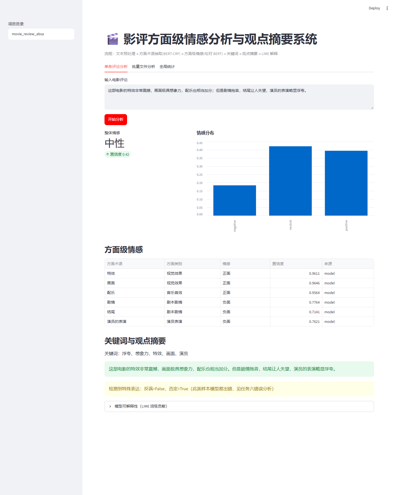
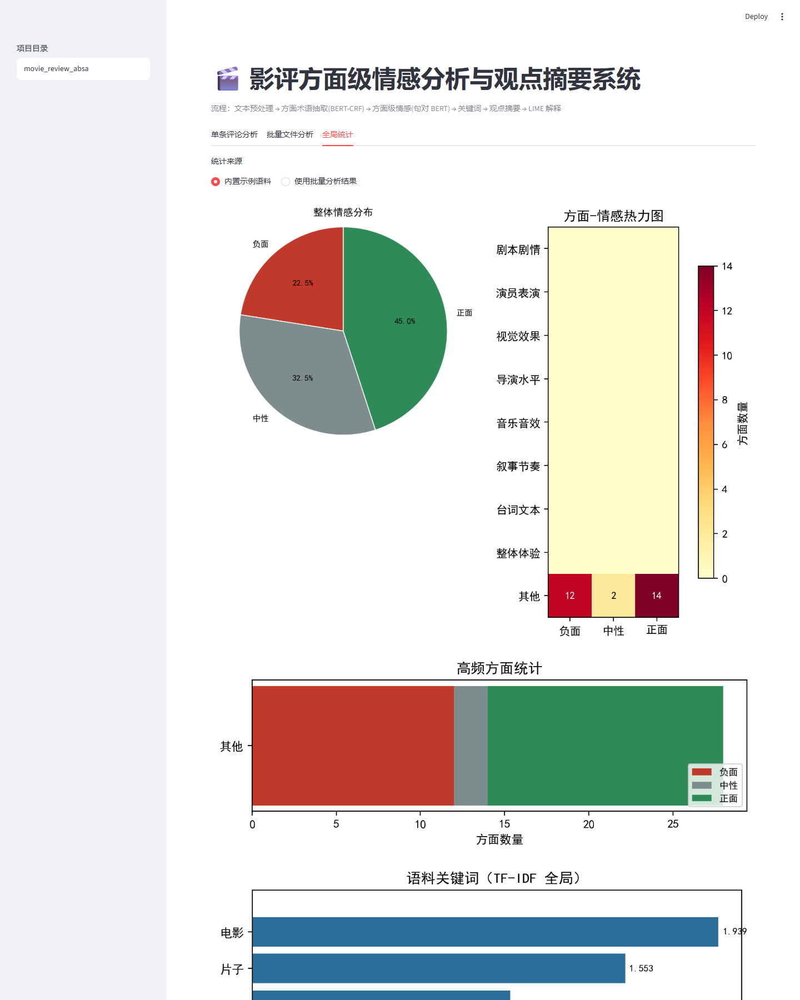
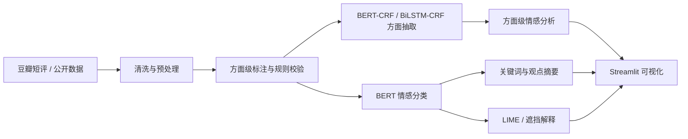

# 影评方面级情感分析与观点摘要系统

基于中文电影短评的 ABSA（Aspect-Based Sentiment Analysis）项目，覆盖数据采集与标注、文本预处理、方面术语抽取、整体 / 方面级情感分类、关键词抽取、观点摘要、可解释性和 Streamlit Web 界面。

项目目标是把一条影评从“自然语言文本”转化为结构化分析结果：这条评论整体是正面、负面还是中性；评论具体在评价哪些电影要素；每个要素的情感是什么；哪些词支持模型判断；最终给出一段可读的观点摘要。

## 成品界面

以下截图来自实际运行的 Streamlit 页面。

| 系统首页 | 单条评论分析 |
| --- | --- |
|  |  |

### 全局统计



## 系统流程



## 网页端功能

系统采用左侧配置、顶部流程提示和三个主标签页的结构。

### 1. 单条评论分析

输入一段电影评论后，页面会展示：

- 整体情感标签与置信度
- 正面 / 中性 / 负面概率柱状图
- 方面术语、方面类别、情感极性和置信度表格
- TF-IDF / TextRank / RAKE 融合关键词
- 观点摘要
- 反讽、否定等特殊表达提示
- 可展开的 LIME 词级贡献图

### 2. 批量文件分析

支持上传 CSV 或 JSONL 文件，按设定条数批量分析并下载结果 CSV。批量任务会显示进度条，结果包括评论原文、整体情感、置信度、方面结果、关键词和摘要。

### 3. 全局统计

支持使用内置示例语料或当前批量分析结果，展示：

- 整体情感分布饼图
- 方面类别 × 情感极性热力图
- 高频方面分布
- 全局关键词分布

## 核心实现

### 1. 数据构建与标注

- 使用公开豆瓣短评数据集，并保留实时爬虫入口。
- 清洗后抽取约 **3051 条**中文电影短评。
- 方面类别限定为 8 类：剧本剧情、演员表演、视觉效果、导演水平、音乐音效、叙事节奏、台词文本、整体体验。
- 方面级标注采用“大模型辅助标注 + 规则校验 + 人工抽检”的流程。
- 方面术语必须能在原文中检索到，类别和极性必须符合标注体系，否则丢弃并回退到词典匹配。

### 2. 文本预处理

- 清洗无关字符和重复文本。
- 使用 jieba 完成分词与词性标注。
- 过滤停用词和低信息量词。
- 使用电影领域自定义词典，改善“剧情、演技、配乐、镜头”等术语的切分效果。

### 3. 方面术语抽取

- **BERT-CRF**：使用中文 BERT 提取上下文表示，再通过 CRF 约束 BIO 标签序列。
- **BiLSTM-CRF**：作为轻量基线，验证不同序列建模方式的效果。
- 输出方面术语及其字符级位置，供后续方面级情感分类使用。

### 4. 整体与方面级情感分类

- 整体情感分类使用中文 BERT 微调，并以 TF-IDF + SVM 作为对比基线。
- 方面级情感分类采用句对输入：

```text
[CLS] 评论正文 [SEP] 方面术语 [SEP]
```

- 模型针对每个方面单独判断 positive / neutral / negative。
- 同时保留三分类和二分类实验结果，便于分析中性类样本不足的问题。

### 5. 关键词与观点摘要

- 使用 TF-IDF、TextRank、RAKE 融合提取关键词。
- 默认采用抽取式摘要，优先选择覆盖主要方面和情感倾向的原文句子。
- 可选接入 DeepSeek / 智谱等大模型生成更自然的摘要，API Key 通过环境变量读取，不写入源码。

### 6. 可解释性与错误分析

- 使用 LIME 计算词级特征贡献。
- 使用逐词遮挡作为 SHAP 的轻量替代。
- 对反讽、否定、隐含方面和方面词边界错误进行分类分析，输出错误案例和错误类型分布。

## 示例分析

输入：

> 这部电影特效非常震撼，画面极具想象力，配乐也相当加分，但是剧情拖沓，结尾让人失望，演员的表演略显浮夸。

输出摘要：

| 方面 | 类别 | 情感 | 置信度 |
| --- | --- | --- | --- |
| 特效 | 视觉效果 | 正面 | 0.962 |
| 画面 | 视觉效果 | 正面 | 0.964 |
| 配乐 | 音乐音效 | 正面 | 0.956 |
| 剧情 | 剧本剧情 | 负面 | 0.778 |
| 结尾 | 剧本剧情 | 负面 | 0.700 |
| 演员的表演 | 演员表演 | 正面 | 0.960 |

系统最终生成观点摘要：

> 特效、画面与配乐表现突出，演员表演获得肯定；剧情拖沓和结尾处理是主要负面反馈。

## 模型评测

评测结果保存在 `metrics/train_metrics.json`。

| 任务 | 模型 | 指标 |
| --- | --- | --- |
| 方面术语抽取 | BERT-CRF | P 0.6538 / R 0.6415 / F1 0.6476 |
| 方面术语抽取 | BiLSTM-CRF | P 0.5702 / R 0.5923 / F1 0.5811 |
| 整体情感（三分类） | BERT | Accuracy 0.6545 / Macro-F1 0.6040 |
| 整体情感（三分类） | TF-IDF + SVM | Accuracy 0.6179 / Macro-F1 0.5555 |
| 整体情感（二分类） | BERT | Accuracy 0.7511 / Macro-F1 0.8059 |
| 方面级情感（二分类） | BERT | Accuracy 0.8175 / Macro-F1 0.8100 |

三分类任务中的中性类样本较少，且短评经常缺少明确态度，因此中性类识别仍是当前主要难点。项目保留混淆矩阵和错误案例，方便继续改进。

## 目录结构

```text
movie-review-absa/
├── app.py                 Streamlit 交互界面
├── train.py               模型训练入口
├── analyze.py             单条 / 批量分析入口
├── src/
│   ├── preprocessor.py    文本预处理
│   ├── aspect_extractor.py BERT-CRF / BiLSTM-CRF
│   ├── sentiment_classifier.py 整体情感与 TF-IDF/SVM 基线
│   ├── absa_classifier.py 方面级情感分类
│   ├── keyword_extractor.py 关键词抽取
│   ├── summarizer.py      观点摘要
│   ├── explainer.py       LIME / 遮挡解释
│   ├── visualizer.py      可视化
│   └── analyzer.py        端到端集成
├── data/                  处理后数据、标注规范与样例
├── metrics/               模型评测指标
├── outputs/               图表、批处理结果与错误分析
├── docs/images/           实际网页运行截图
└── notebooks/             完整实验 Notebook
```

## 快速开始

```bash
python -m venv .venv
source .venv/bin/activate
pip install -r requirements.txt
```

Windows：

```powershell
python -m venv .venv
.venv\Scripts\Activate.ps1
pip install -r requirements.txt
```

### 训练模型

```bash
python train.py --epochs 2 --max-samples 800
```

### 单条分析

```bash
python analyze.py --text "特效很震撼，但剧情拖沓"
```

### 批量分析

```bash
python analyze.py --input data/reviews_raw_unlabeled.jsonl --output outputs/batch.csv --limit 20
```

### 启动网页

```bash
streamlit run app.py
```

启动后默认打开三个标签页：单条评论分析、批量文件分析、全局统计。

## 仓库说明

- 仓库不包含原始 57 MB 数据缓存、BERT 权重和训练中间文件，避免仓库体积过大。
- 模型可按 `train.py` 重新训练；评测指标、处理后数据和示例输出已经保留。
- 截图来自本地完整模型部署，仓库中的轻量代码版本需要先准备模型权重后再运行完整分析。
- 可选大模型能力通过 `DEEPSEEK_API_KEY`、`ZHIPUAI_API_KEY` 读取。

## 技术栈

Python · PyTorch · Transformers · BERT-CRF · BiLSTM-CRF · scikit-learn · jieba · TextRank · RAKE · LIME · matplotlib · Streamlit

## 已知限制与改进方向

- 短评平均长度较短，篇章级摘要和复杂多观点冲突尚未覆盖。
- 反讽、双重否定和隐含方面是主要错误来源。
- 中性类样本不足，后续可增加类别平衡、数据增强和对比学习。
- 可进一步尝试方面-情感联合建模、TinyBERT 蒸馏和 FastAPI 服务化部署。
