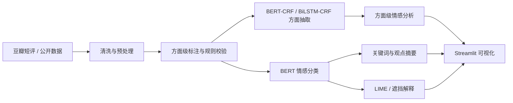
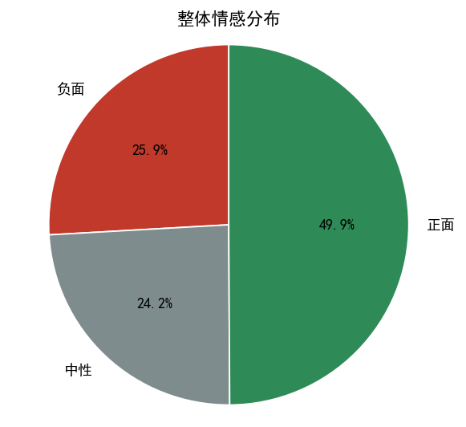
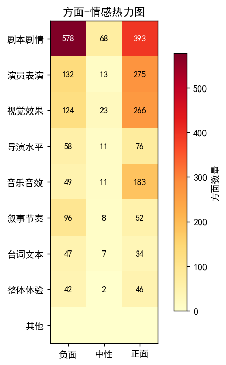
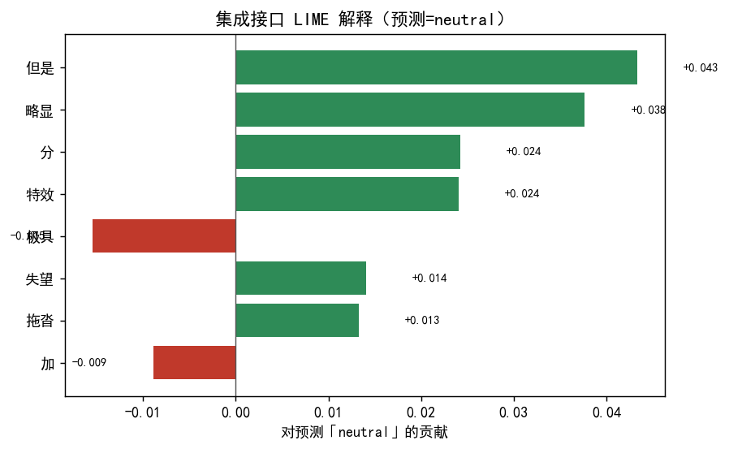

# 影评方面级情感分析与观点摘要系统

基于中文电影短评的 ABSA（Aspect-Based Sentiment Analysis）综合项目，覆盖数据构建、方面术语抽取、整体 / 方面级情感分类、关键词抽取、观点摘要、可解释性与 Streamlit 可视化。

## 系统流程



## 实现效果

| 整体情感分布 | 方面-情感热力图 |
| --- | --- |
|  |  |



### 示例分析

输入：

> 这部电影特效非常震撼，画面极具想象力，配乐也相当加分，但是剧情拖沓，结尾让人失望，演员的表演略显浮夸。

输出摘要：

| 方面 | 类别 | 情感 | 置信度 |
| --- | --- | --- | --- |
| 特效 | 视觉效果 | 正面 | 0.962 |
| 画面 | 视觉效果 | 正面 | 0.964 |
| 配乐 | 音乐音效 | 正面 | 0.956 |
| 剧情 | 剧本剧情 | 负面 | 0.778 |
| 结尾 | 剧本剧情 | 负面 | 0.700 |
| 演员的表演 | 演员表演 | 正面 | 0.960 |

系统最终生成观点摘要：

> 特效、画面与配乐表现突出，演员表演获得肯定；剧情拖沓和结尾处理是主要负面反馈。

## 核心能力

| 模块 | 实现 |
| --- | --- |
| 数据构建 | 公开豆瓣短评缓存、实时爬虫补充、分层抽样、方面级标注与质量审查 |
| 文本预处理 | 清洗、分词、词性标注、停用词过滤、领域词典 |
| 方面术语抽取 | BERT-CRF、BiLSTM-CRF |
| 整体情感分类 | 中文 BERT 微调 + TF-IDF / SVM 基线 |
| 方面级情感分类 | `[CLS] 评论 [SEP] 方面 [SEP]` 句对 BERT |
| 关键词抽取 | TF-IDF、TextRank、RAKE 融合 |
| 观点摘要 | 抽取式摘要，可选大模型生成式摘要 |
| 可解释性 | LIME 词级贡献、逐词遮挡、错误类型分析 |
| 可视化交互 | Streamlit 单条分析、批量分析与全局统计 |

## 数据与标注

- 语料规模：清洗后约 **3051 条**中文电影短评。
- 原始公开数据集：`Leoooooops/douban_movie_comments`。
- 整体情感标签由豆瓣星级映射：1–2 星负面、3 星中性、4–5 星正面。
- 方面级标注采用“大模型辅助标注 + 规则校验 + 人工抽检”。
- 方面类别限定为 8 类：剧本剧情、演员表演、视觉效果、导演水平、音乐音效、叙事节奏、台词文本、整体体验。
- 标注术语必须出现在原文中，类别和极性必须符合预定义体系，否则丢弃并回退到词典匹配。

## 评测结果

评测结果保存在 `metrics/train_metrics.json`，主要包括：

| 任务 | 模型 | 指标 |
| --- | --- | --- |
| 方面术语抽取 | BERT-CRF | P 0.6538 / R 0.6415 / F1 0.6476 |
| 方面术语抽取 | BiLSTM-CRF | P 0.5702 / R 0.5923 / F1 0.5811 |
| 整体情感（三分类） | BERT | Accuracy 0.6545 / Macro-F1 0.6040 |
| 整体情感（三分类） | TF-IDF + SVM | Accuracy 0.6179 / Macro-F1 0.5555 |
| 整体情感（二分类） | BERT | Accuracy 0.7511 / Macro-F1 0.8059 |
| 方面级情感（二分类） | BERT | Accuracy 0.8175 / Macro-F1 0.8100 |

说明：三分类中的中性类样本较少，且短评语境经常缺少明确态度，因此中性类识别仍是当前主要难点。项目保留完整混淆矩阵和错误案例，便于继续改进。

## 目录结构

```text
movie-review-absa/
├── app.py                 Streamlit 交互界面
├── train.py               模型训练入口
├── analyze.py             单条 / 批量分析入口
├── src/
│   ├── preprocessor.py    文本预处理
│   ├── aspect_extractor.py BERT-CRF / BiLSTM-CRF
│   ├── sentiment_classifier.py 整体情感与 TF-IDF/SVM 基线
│   ├── absa_classifier.py 方面级情感分类
│   ├── keyword_extractor.py 关键词抽取
│   ├── summarizer.py      观点摘要
│   ├── explainer.py       LIME / 遮挡解释
│   ├── visualizer.py      可视化
│   └── analyzer.py        端到端集成
├── data/                  处理后数据、标注规范与样例
├── metrics/               评测指标
├── outputs/               图表、批处理结果与错误分析
└── notebooks/             完整实验 Notebook
```

## 快速开始

```bash
python -m venv .venv
source .venv/bin/activate
pip install -r requirements.txt
```

Windows：

```powershell
python -m venv .venv
.venv\Scripts\Activate.ps1
pip install -r requirements.txt
```

### 训练

```bash
python train.py --epochs 2 --max-samples 800
```

### 单条分析

```bash
python analyze.py --text "特效很震撼，但剧情拖沓"
```

### 批量分析

```bash
python analyze.py --input data/reviews_raw_unlabeled.jsonl --output outputs/batch.csv --limit 20
```

### 启动界面

```bash
streamlit run app.py
```

## 仓库说明

- 原始 57 MB 数据缓存、BERT 权重、训练中间文件和 `.env` 不进入仓库。
- 模型可按 `train.py` 重新训练；评测指标和示例输出已经保留。
- 可选的大模型辅助标注或生成式摘要通过环境变量 `DEEPSEEK_API_KEY`、`ZHIPUAI_API_KEY` 读取。

## 技术栈

Python · PyTorch · Transformers · BERT-CRF · BiLSTM-CRF · scikit-learn · jieba · TextRank · LIME · matplotlib · Streamlit

## 已知限制与改进方向

- 短评平均长度较短，篇章级摘要和复杂多观点冲突尚未覆盖。
- 反讽、双重否定和隐含方面是主要错误来源。
- 中性类样本不足，后续可增加类别平衡、数据增强和对比学习。
- 可进一步尝试方面-情感联合建模、TinyBERT 蒸馏和 FastAPI 服务化部署。
